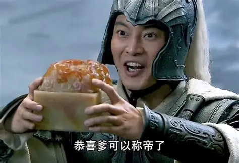
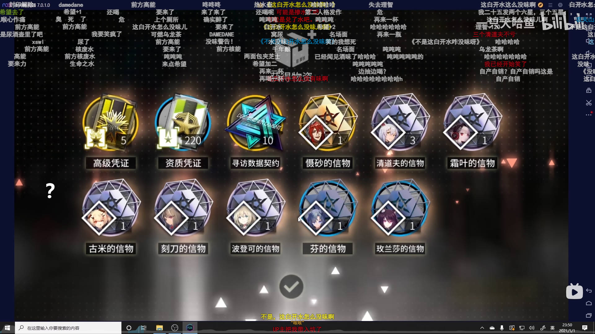

游戏时长：40+连续玩5天
进度：成为天下第一并且成为皇帝结局
从夯到拉评价：人上人
# 前言
  我就不应该看[单机肥肥王日君](https://space.bilibili.com/1069246841)的这个视频
  [从夯到拉评我玩过的11个武侠仙侠游戏【巨辩隐藏关】](https://www.bilibili.com/video/BV1ehgV6REAH)
  今天再思考一下，其实与其叫测评，实际上文章没有对“测”这一块大谈特谈，主要集中在主观的“评”上，但一般输出文章之后我就没有复盘了，游戏卸载早了。在这留下思考的结果，希望能够提供一些“测”相关的思考。

  再加上最近看了童子军大王的视频，我觉得我需要对文章的结构进行一些修改。

# 介绍
  由于太长了，我将进行简短说明。
  你将扮演一个小虾米，从树上掉下了小虾米，在陷入大侠立志传最中心，九州最中间的地方开启你的大侠之旅。
  你将和世界里的人打个招呼，深入了解，背后偷取，游戏四海八荒。然后发现一文钱难倒英雄汉，开始殴打小蛇，殴打野猪，殴打蝎子、狼，殴打你见到的野怪，用它们的冰冷的掉落物换取温暖的铜钱。
  期间你能够坑蒙拐骗或者依靠充分的武德收养鸡，和野猪、狼、熊、虎聊天对话，你吃了吗？我吃了，你呢？然后其中一只，只有一只宠物在你的身边与你出入江湖，说是出入江湖，闲的时候在大地图上逛拿宠物站起来蹬，骑着宠物翻山越岭。
  找呀找呀找情缘，找到一个好情缘。无论是猎虎、屠夫、少侠、捕快，邋遢酒鬼等，都能够尝试邀请成为伙伴一起游历江湖，并处理他们独特的剧情任务。
  发现自身的功法只能依靠他人提供，不拜码头难以成为大侠，不断地获取功法和装备并与朝廷和江湖周旋。当铺混的太熟都能当掌柜了，赌场从横太深已经成千王之王。可装备不强，功法不行就会导致成为路边一条，看着滚出主菜单的狗图再次点开继续游戏，又四处想办法尝胆，所谓胜兵必骄、骄兵必败、败兵必哀、哀兵必胜，小虾米也有明天。不断地送礼，买东西，吃东西，送香火，采木矿，偷好物，不断地壮大自己，而不是打不过，见狗图，滚到主菜单，然后打不过，见狗图，滚到主菜单循环。
  最终到了100级发现干不过掌门，即使暗器使得贼六，也没有招数，在反复机械的活动下，发现了悟道碑里的神奇功能，融合功法。原来金色品质不是最强的，红色才是最强的！所以小虾米不做弟子了，各派掌门。天下第一，Kono 小虾米 da！

# 优点
  用 3 个以内的关键词概括这款游戏给你的整体感受，核心的加分 / 减分项是什么？
  
  关键词：棋盘回合，RPG，武侠

加分项：
1. 探索冒险。当你出了无名小村，有许多的剧情设计和位置区域探索。并不是线性的规划。这似乎是所有RPG的加分项，但这一点确实是游戏的优点。比如刷出了的战斗结果是“一拳超人”直接成路边一条，又或者是磕头能磕出本功法。
2. 任务剧情。过多的任务剧情，量大管饱。你会与多样的NPC有不同的任务剧情，并且获得不同的细节剧情。比如关照你的师兄，神奇的悟空，以及好的情缘。
3. 地图设计。虽然没有制作较大的场景来实现自然地场景切换，而是利用不一样的地图设计来实现箱庭结构，将关卡场景拼在一起来构建一个具有一定自由度和探索的世界。这个设计我是第一次游玩到，类似的是《鬼谷八荒》，但鬼谷八荒太大了，且地图也有交互部分显得不够独特。我想到了《三国志·战略版》但我没有玩太久所以感受不是很深。
4. 能力系统。打工吧，小虾米！众多同题材游戏都有这个，所以本作品也不能少。玩家能体验地东西多了去了，砍树、挖矿、捕虫、钓鱼、采药、机关、口才、识别物品等，想干什么干什么，多种能力多种体验。当然其最奇特的当然就是偷盗能力，相比于《逸剑风云决》的到处切磋，哪有“大侠快偷”刺激。
5. 特殊支线。比如悬赏那里有特殊悬赏，到让我感到小小的有趣。
# 缺点
关键词：数值战斗，流水剧情，

1. 战斗体验。
  战斗需要功法和等级，等级还好说能够通过获得的点数升级，就像我玩过的传奇类网游一样，然后我就像是个傻呗在叶家军的线路选择了剑修，拿着那破大宝剑一点用都没有。进入道玄宗也不能快速获得功法，也看不到功法获得途径。拿着大宝剑的小虾米经历的是《刘十八捕兽枪》，刘十八的回合，刘十八的回合，还是刘十八的回合，刘十八定住了小虾米，使出了《捕兽叉法》。？我在玩什么？至于武器的获取，由于我不怎么扒队友装备，并且紫武只有手上这一把，就到了后期150天左右！装备获取不知道，偏主线的剧情是“叶家军”、和稍微大型的支线，但是功法遗忘就需要重学，对于前期来说成本较高，我就没有从剑法再次切换到别的了。我道玄宗的最佳功法没拿，我能离开道玄宗去加入名剑山庄吗？我一周目不杀独孤剑一就没别的法子获得武器？有的兄弟，有的，神捕门，我的档神捕门掌门不见了！
  战斗体验的总结是数值游戏，秒杀敌人，有来有回，打不过。就只有这三者，基本5回合就能解决，就像是在《三国演义》，我能5回合打不过非首领角色都得夸你一句“周仓”。我不理解“方啸天”的设计，对比攻击力和防御力，差距不是装备就是血量了，血厚的跟吃了仙丹似的。击杀成功但“凤璇玑”死了我也没赢啊。
  至于Buff和一些数值的搭配我认为是添料，核心功法和装备流程体验不是很开心就不细研究其他部分了。
2. 弱引导和能力设计。
  弱引导。既然是自由探索，玩家也不爽啊。《艾尔登法环》探索一个区域也能够获得一定物品和收获。而除了无名小村这一较为丰富完整的区域后，其他地方是基于任务和提示而引导的探索。但是探索基本提供的是负反馈，比如衙门需要机关三级，青云观垫子的获取。
  但这些还不是重点，重点是装备和功法。太黑暗森林了，无名无派不配获得剑法，剑法在别人手里，得完成宗门最终任务才能获得最强剑法。我都不好脱身道玄宗去剑庄。而打造武器需要的经验值太高不好刷，材料还不能做到互通和有效利用，千年玄冰只能靠拍卖，千年玄铁造剑。那我问你，百炼精金干什么用的？天外陨石干什么用的？那个欧阳恒一天天的就找我要千年玄铁，千年玄铁是每次采矿都有的吗？是金色传说都是千年玄铁吗？Look in my eyes! Tell me!同样的事情在做衣服上也适用，也没有“名衣纺”、“名造局”。
  那这些能力就摆设呗，不提供足够的正反馈，还提供负反馈，膈应。还有体力的设计，实在是影响探索，这和之前我看的网络评价体验：《极少数》心情老是低谷差不多啊。
3. 剧情。
  剧情深度鸡肋。主线剧情不用说，但大部分就像是小甜点，不是个个玩家都是菜月昴，一点点甜就足够了。其中伙伴支线、宗门支线、势力（叶家军）支线都是具有一定剧情演绎和表现，但是深度并不是很强。音乐，文本，流程，画面表现，在简陋的框架下表现的只有简陋，我宁愿玩Galgame，因为它没有战斗，如果《P5R》没有强制战斗结算我也会很开心的。不够爽也没有令人惊艳的地方。部分支线过于廉价。比如严如蕊、鱼薇儿纯送的啊，配件。没有深度，正常思路会收严如蕊吗？为收而收不就廉价吗？而没有深度我觉得剧情不如去看番茄小说十章。
  最后打赢康王、齐王就显得流水线，结局是送的。柴王能出来装就离谱，其他士族没声音了，当然这是游戏。而打赢柴王强制解决，小虾米称帝了，不好的战斗以及纯靠对话系统支撑的剧情体验也就这样了。
  

# 总结
  总体评价：一款量大管饱的武侠幻想，棋盘回合制战斗，世界探索RPG。
  
核心流程：探索交互，对话剧情，数值战斗，重复提升自身数值再循环前三者。

最爽的地方：
- 切磋打过掌门了，熬出头了：（
- 悟道碑就是牛！
最难受的地方：
- 怎么打不过啊，提升无门路！
长期游玩体验：快速下降，大概游戏里50天左右除了重复刷怪，不加入宗门的前提下已不好提升角色数值了。

核心原因：种种机制导致的不够爽。

学习搞个综合评分：
- 支线设计：4/10。主要是量大管饱和部分小巧思。
- 关卡设计：3/10。地图关卡偏线性。最终深入区域和旁支。简单设计。
- 玩法系统：6/10。各种机制并没有融合的非常好，有极大地改良设计潜力。
- 开放设计：4/10。很好的四处探索，也仅仅是能够四处探索。
- 叙事手法：6/10。无名小村的剧情设计和叙事较为紧凑和好，但后面无法维持高剧情设计。
- 角色：3/10。树上掉下来的大侠。多看《仙剑3》吧，永安当的小伙计也比树上掉下来的大侠更加丰满。

# 游玩动机与情绪价值
  你玩这款游戏最核心的诉求是什么（比如策略成就感、消磨时间、剧情沉浸、社交互动、操作爽感等）？它有没有满足你的预期？游玩过程中正面情绪和负面情绪的占比大概是多少？

最核心诉求：是谁把它和《逸剑风云决》搞成近几年武侠游戏双臂的？游戏性！游戏性！剧情！剧情！

正面情绪和负面情绪的占比：2/8
# 横向对比与最终定位
和同类型热门游戏 / 系列前作相比，这款游戏最大的优势和短板分别是什么？最终你会给它一个怎样的游玩定位（比如必玩、可玩、避雷）？
可玩。由于我玩了《逸剑风云决》我可以评价武侠游戏了。

对比《逸剑风云决》：
  战斗。一般游戏性要以游戏核心流程和剧情来撑起主要游玩体验，我不可能进去玩内力震骰子出千吧。战斗无法去自由的搭配功法，装备也不能很好的获取。
  剧情。鸡肋。
  支线。有大型支线的《逸剑风云决》还能说什么呢？丰富度同比下是要强于《大侠立志传》的。
  至于地图体验和采集还有制作我不说了。
  爽是重点，爽就完事了。
  武侠感的话。《大侠立志传》的当皇帝我能去多看看历史会觉得更佳，后面的结局送的太白了，和白开水一样怎么没味啊。由于剧情反馈并不是很深，我没什么武侠感，江湖事倒是江湖了。但是涉及朝廷的反而显得不够“侠”从我的角度，而“叶家军”支线，都成将军了，加入朝廷了，反而武侠感不高了，是叶家子弟了。手里有兵都能清君侧了。
  
# 结语
  视情况学习其他人的良好制作。由于大晚上制作有点仓促，我想学习一下童子军大王的文案风格的，但本文应该达不到他的作品程度。

  我朋友告诉我玩游戏要先看评分，可是也有其他玩家告诉我只有玩了才知道适不适合。我觉得该早点弃坑弃坑，该减少游戏寿命减少游戏寿命，当你觉得这游戏不值得玩的时候请珍惜自己的时间，这游戏不适合你。

  时效性的话，我想说我看了[谈谈死亡/未来的告别视频](https://www.bilibili.com/video/BV1JbJR66EuL)
  想做什么就早点做吧。我想保持这份输出来记录生活吧，再拖可能不想整这个了，每个人都有别的事要忙。
  晚安各位。